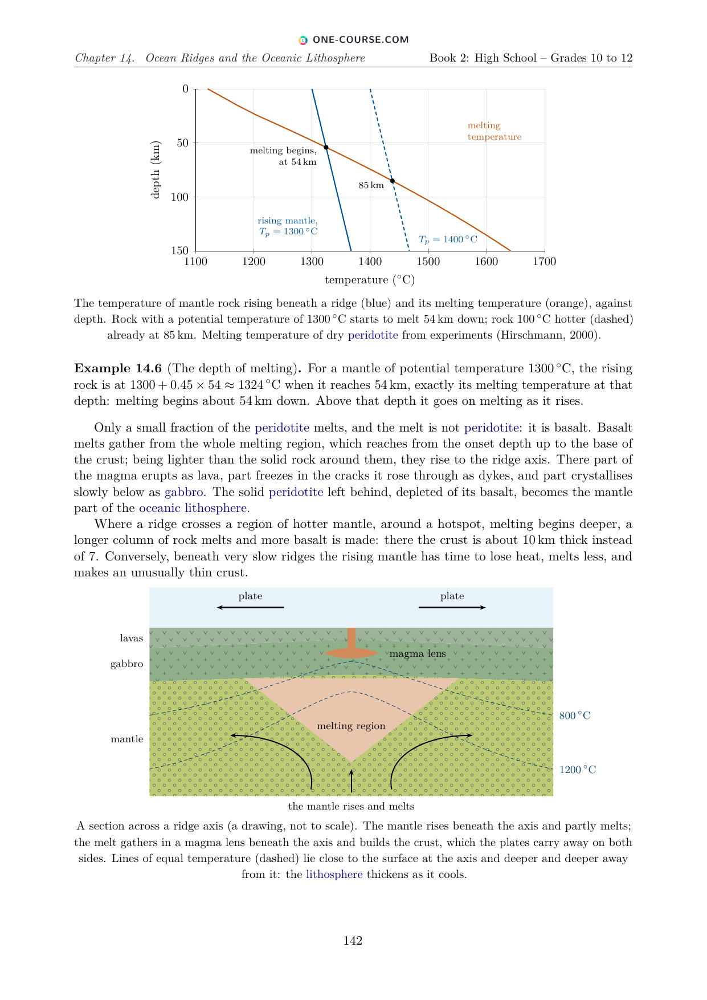
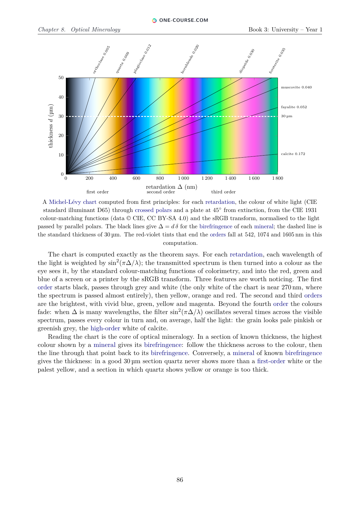
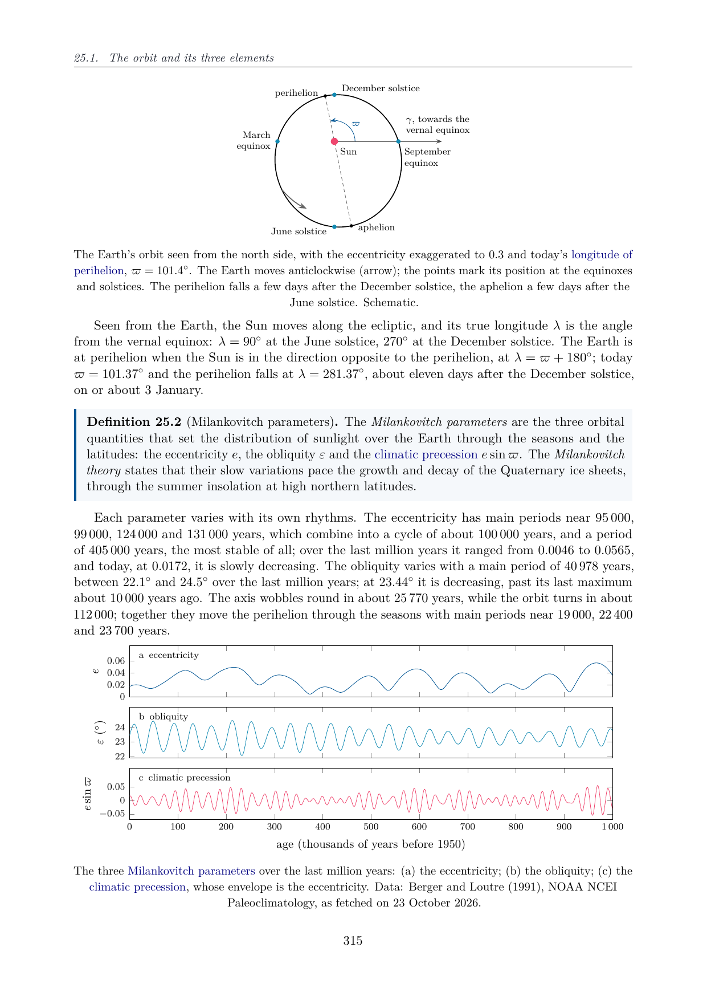

# One Earth and Space Sciences Book

<p align="center">
  <a href="https://one-course.com">
    
  </a>
</p>

<p align="center">
  <a href="https://github.com/bvirrion/one-earth-and-space-sciences-book/releases/latest"></a>
  <a href="https://github.com/bvirrion/one-earth-and-space-sciences-book/releases"></a>
  <a href="https://github.com/bvirrion/one-earth-and-space-sciences-book/actions/workflows/release.yml"></a>
  <a href="https://one-course.com/books"></a>
</p>

*The One Earth and Space Sciences Book to Rule Them All.*

> **One Earth and Space Sciences Book** is part of the **One Course** project — one coherent
> course covering each subject from kindergarten to the end of the
> bachelor's degree. Discover the whole project at
> **[one-course.com](https://one-course.com)**, and see the siblings
> [One Math Book](https://github.com/bvirrion/one-math-book),
> [One Physics Book](https://github.com/bvirrion/one-physics-book),
> [One Chemistry Book](https://github.com/bvirrion/one-chemistry-book),
> [One Biology Book](https://github.com/bvirrion/one-biology-book),
> [One Computer Science Book](https://github.com/bvirrion/one-computer-science-book),
> [One Economics Book](https://github.com/bvirrion/one-economics-book) and
> [One Quant Book](https://github.com/bvirrion/one-quant-book).

A series of five **free Earth and space science textbooks** forming a single
coherent course **from Grade 1 to the end of the bachelor's degree** — one
notation, one voice, every year building on the previous one. Each book is
available in eight complete editions: **English, French, Dutch, Spanish, Portuguese, Hindi, Arabic and Indonesian**, plus a
**Simplified Chinese** edition (PDF only for now). Whether you are a student,
a parent, a teacher or a homeschooling family, you can read every book online
or download the PDF — free of charge:

1. **Primary & Middle School Earth and Space Sciences** — Grades 1–9;
2. **High School Earth and Space Sciences** — Grades 10–12;
3. **University Earth and Space Sciences — Year 1**;
4. **University Earth and Space Sciences — Year 2**;
5. **University Earth and Space Sciences — Year 3**.

The course covers the solid Earth (rocks and minerals, plate tectonics,
earthquakes and volcanoes, geological maps), its fluid envelopes (weather,
oceans, climate), the history of the planet and of life, and the sky
(the Solar System, stars and galaxies). Physics, chemistry and biology
keep the notions they own; this series recalls them and builds the Earth or
space angle. The two school volumes **never repeat themselves**: each notion
has one chapter that owns it.

The style is concise and rigorous: courses built from **definitions,
examples, propositions and methods**, followed by graded **exercises and a
weekend problem with full solutions** collected at the end of each book.

- **Real data.** World maps, plate boundaries, earthquakes, volcanoes, the
  Earth's interior, carbon dioxide and temperature records are drawn from
  published datasets, fetched and derived by a script in the repository, with
  the source named under the figure.
- **Sourced numbers.** Every measured value goes through a data ledger that
  names its source.
- **One region to practise on.** Maps, cross-sections and field exercises use
  an invented region, the Varden Hills, generated by tested code, so every
  three-point problem and every section has an exact answer.
- **Observation only.** Fieldwork is written as observation: no chapter tells
  the reader to climb a cliff, enter a quarry or look at the Sun.

Thousands of generated hyperlinks send every defined term back to its
definition, and every exercise to its solution.

<p align="center">
  
  
  
</p>
<p align="center"><sub>Three pages: an ocean ridge (Book 2), optical mineralogy (Book 3), orbital climate forcing (Book 4).</sub></p>

## Read online · Download the PDFs

| Book | Read online | Download PDF |
|------|-------------|--------------|
| **1. Primary & Middle School** (Grades 1–9) | [EN](https://one-course.com/books/earth/1/en) · [ES](https://one-course.com/books/earth/1/es) · [FR](https://one-course.com/books/earth/1/fr) · [HI](https://one-course.com/books/earth/1/hi) · [AR](https://one-course.com/books/earth/1/ar) · [ID](https://one-course.com/books/earth/1/id) · [NL](https://one-course.com/books/earth/1/nl) · [PT](https://one-course.com/books/earth/1/pt) | [EN](https://github.com/bvirrion/one-earth-and-space-sciences-book/releases/latest/download/one_earth_and_space_sciences_book_1_primary_middle_school.pdf) · [ES](https://github.com/bvirrion/one-earth-and-space-sciences-book/releases/latest/download/one_earth_and_space_sciences_book_1_primary_middle_school_es.pdf) · [FR](https://github.com/bvirrion/one-earth-and-space-sciences-book/releases/latest/download/one_earth_and_space_sciences_book_1_primary_middle_school_fr.pdf) · [HI](https://github.com/bvirrion/one-earth-and-space-sciences-book/releases/latest/download/one_earth_and_space_sciences_book_1_primary_middle_school_hi.pdf) · [AR](https://github.com/bvirrion/one-earth-and-space-sciences-book/releases/latest/download/one_earth_and_space_sciences_book_1_primary_middle_school_ar.pdf) · [ID](https://github.com/bvirrion/one-earth-and-space-sciences-book/releases/latest/download/one_earth_and_space_sciences_book_1_primary_middle_school_id.pdf) · [NL](https://github.com/bvirrion/one-earth-and-space-sciences-book/releases/latest/download/one_earth_and_space_sciences_book_1_primary_middle_school_nl.pdf) · [PT](https://github.com/bvirrion/one-earth-and-space-sciences-book/releases/latest/download/one_earth_and_space_sciences_book_1_primary_middle_school_pt.pdf) · [ZH](https://github.com/bvirrion/one-earth-and-space-sciences-book/releases/latest/download/one_earth_and_space_sciences_book_1_primary_middle_school_zh.pdf) |
| **2. High School** (Grades 10–12) | [EN](https://one-course.com/books/earth/2/en) · [ES](https://one-course.com/books/earth/2/es) · [FR](https://one-course.com/books/earth/2/fr) · [HI](https://one-course.com/books/earth/2/hi) · [AR](https://one-course.com/books/earth/2/ar) · [ID](https://one-course.com/books/earth/2/id) · [NL](https://one-course.com/books/earth/2/nl) · [PT](https://one-course.com/books/earth/2/pt) | [EN](https://github.com/bvirrion/one-earth-and-space-sciences-book/releases/latest/download/one_earth_and_space_sciences_book_2_high_school.pdf) · [ES](https://github.com/bvirrion/one-earth-and-space-sciences-book/releases/latest/download/one_earth_and_space_sciences_book_2_high_school_es.pdf) · [FR](https://github.com/bvirrion/one-earth-and-space-sciences-book/releases/latest/download/one_earth_and_space_sciences_book_2_high_school_fr.pdf) · [HI](https://github.com/bvirrion/one-earth-and-space-sciences-book/releases/latest/download/one_earth_and_space_sciences_book_2_high_school_hi.pdf) · [AR](https://github.com/bvirrion/one-earth-and-space-sciences-book/releases/latest/download/one_earth_and_space_sciences_book_2_high_school_ar.pdf) · [ID](https://github.com/bvirrion/one-earth-and-space-sciences-book/releases/latest/download/one_earth_and_space_sciences_book_2_high_school_id.pdf) · [NL](https://github.com/bvirrion/one-earth-and-space-sciences-book/releases/latest/download/one_earth_and_space_sciences_book_2_high_school_nl.pdf) · [PT](https://github.com/bvirrion/one-earth-and-space-sciences-book/releases/latest/download/one_earth_and_space_sciences_book_2_high_school_pt.pdf) · [ZH](https://github.com/bvirrion/one-earth-and-space-sciences-book/releases/latest/download/one_earth_and_space_sciences_book_2_high_school_zh.pdf) |
| **3. University — Year 1** | [EN](https://one-course.com/books/earth/3/en) · [ES](https://one-course.com/books/earth/3/es) · [FR](https://one-course.com/books/earth/3/fr) · [HI](https://one-course.com/books/earth/3/hi) · [AR](https://one-course.com/books/earth/3/ar) · [ID](https://one-course.com/books/earth/3/id) · [NL](https://one-course.com/books/earth/3/nl) · [PT](https://one-course.com/books/earth/3/pt) | [EN](https://github.com/bvirrion/one-earth-and-space-sciences-book/releases/latest/download/one_earth_and_space_sciences_book_3_university_year_1.pdf) · [ES](https://github.com/bvirrion/one-earth-and-space-sciences-book/releases/latest/download/one_earth_and_space_sciences_book_3_university_year_1_es.pdf) · [FR](https://github.com/bvirrion/one-earth-and-space-sciences-book/releases/latest/download/one_earth_and_space_sciences_book_3_university_year_1_fr.pdf) · [HI](https://github.com/bvirrion/one-earth-and-space-sciences-book/releases/latest/download/one_earth_and_space_sciences_book_3_university_year_1_hi.pdf) · [AR](https://github.com/bvirrion/one-earth-and-space-sciences-book/releases/latest/download/one_earth_and_space_sciences_book_3_university_year_1_ar.pdf) · [ID](https://github.com/bvirrion/one-earth-and-space-sciences-book/releases/latest/download/one_earth_and_space_sciences_book_3_university_year_1_id.pdf) · [NL](https://github.com/bvirrion/one-earth-and-space-sciences-book/releases/latest/download/one_earth_and_space_sciences_book_3_university_year_1_nl.pdf) · [PT](https://github.com/bvirrion/one-earth-and-space-sciences-book/releases/latest/download/one_earth_and_space_sciences_book_3_university_year_1_pt.pdf) · [ZH](https://github.com/bvirrion/one-earth-and-space-sciences-book/releases/latest/download/one_earth_and_space_sciences_book_3_university_year_1_zh.pdf) |
| **4. University — Year 2** | [EN](https://one-course.com/books/earth/4/en) · [ES](https://one-course.com/books/earth/4/es) · [FR](https://one-course.com/books/earth/4/fr) · [HI](https://one-course.com/books/earth/4/hi) · [AR](https://one-course.com/books/earth/4/ar) · [ID](https://one-course.com/books/earth/4/id) · [NL](https://one-course.com/books/earth/4/nl) · [PT](https://one-course.com/books/earth/4/pt) | [EN](https://github.com/bvirrion/one-earth-and-space-sciences-book/releases/latest/download/one_earth_and_space_sciences_book_4_university_year_2.pdf) · [ES](https://github.com/bvirrion/one-earth-and-space-sciences-book/releases/latest/download/one_earth_and_space_sciences_book_4_university_year_2_es.pdf) · [FR](https://github.com/bvirrion/one-earth-and-space-sciences-book/releases/latest/download/one_earth_and_space_sciences_book_4_university_year_2_fr.pdf) · [HI](https://github.com/bvirrion/one-earth-and-space-sciences-book/releases/latest/download/one_earth_and_space_sciences_book_4_university_year_2_hi.pdf) · [AR](https://github.com/bvirrion/one-earth-and-space-sciences-book/releases/latest/download/one_earth_and_space_sciences_book_4_university_year_2_ar.pdf) · [ID](https://github.com/bvirrion/one-earth-and-space-sciences-book/releases/latest/download/one_earth_and_space_sciences_book_4_university_year_2_id.pdf) · [NL](https://github.com/bvirrion/one-earth-and-space-sciences-book/releases/latest/download/one_earth_and_space_sciences_book_4_university_year_2_nl.pdf) · [PT](https://github.com/bvirrion/one-earth-and-space-sciences-book/releases/latest/download/one_earth_and_space_sciences_book_4_university_year_2_pt.pdf) · [ZH](https://github.com/bvirrion/one-earth-and-space-sciences-book/releases/latest/download/one_earth_and_space_sciences_book_4_university_year_2_zh.pdf) |
| **5. University — Year 3** | [EN](https://one-course.com/books/earth/5/en) · [ES](https://one-course.com/books/earth/5/es) · [FR](https://one-course.com/books/earth/5/fr) · [HI](https://one-course.com/books/earth/5/hi) · [AR](https://one-course.com/books/earth/5/ar) · [ID](https://one-course.com/books/earth/5/id) · [NL](https://one-course.com/books/earth/5/nl) · [PT](https://one-course.com/books/earth/5/pt) | [EN](https://github.com/bvirrion/one-earth-and-space-sciences-book/releases/latest/download/one_earth_and_space_sciences_book_5_university_year_3.pdf) · [ES](https://github.com/bvirrion/one-earth-and-space-sciences-book/releases/latest/download/one_earth_and_space_sciences_book_5_university_year_3_es.pdf) · [FR](https://github.com/bvirrion/one-earth-and-space-sciences-book/releases/latest/download/one_earth_and_space_sciences_book_5_university_year_3_fr.pdf) · [HI](https://github.com/bvirrion/one-earth-and-space-sciences-book/releases/latest/download/one_earth_and_space_sciences_book_5_university_year_3_hi.pdf) · [AR](https://github.com/bvirrion/one-earth-and-space-sciences-book/releases/latest/download/one_earth_and_space_sciences_book_5_university_year_3_ar.pdf) · [ID](https://github.com/bvirrion/one-earth-and-space-sciences-book/releases/latest/download/one_earth_and_space_sciences_book_5_university_year_3_id.pdf) · [NL](https://github.com/bvirrion/one-earth-and-space-sciences-book/releases/latest/download/one_earth_and_space_sciences_book_5_university_year_3_nl.pdf) · [PT](https://github.com/bvirrion/one-earth-and-space-sciences-book/releases/latest/download/one_earth_and_space_sciences_book_5_university_year_3_pt.pdf) · [ZH](https://github.com/bvirrion/one-earth-and-space-sciences-book/releases/latest/download/one_earth_and_space_sciences_book_5_university_year_3_zh.pdf) |

The eight complete editions of every book can be read online, chapter by
chapter (the Chinese edition is PDF only for now, and is a first pass: please
report anything that reads wrong). The PDF links always point at the newest
release. Spotted a mistake in any book? Please
[report an erratum](https://github.com/bvirrion/one-earth-and-space-sciences-book/issues/new?template=errata.yml) —
fixes usually ship within days.

## Current status

**All five books are written, and every one ships in eight complete
editions** (same chapters, same labels, same figures): 151 chapters in all.

| Book | Level | Status |
|------|-------|--------|
| Primary & Middle School | Grades 1–9 (age 6–15) | ✅ 32 chapters, 370 exercises, 20 weekend problems, solutions — about 330 pages |
| High School | Grades 10–12 (age 15–18) | ✅ 28 chapters, 420 exercises, 28 weekend problems, solutions — about 365 pages |
| University — Year 1 | Bachelor Year 1 (age 18–19) | ✅ 29 chapters, 348 exercises, 29 weekend problems, solutions — about 475 pages |
| University — Year 2 | Bachelor Year 2 (age 19–20) | ✅ 31 chapters, 372 exercises, 31 weekend problems, solutions — about 485 pages |
| University — Year 3 | Bachelor Year 3 (age 20–21) | ✅ 31 chapters, 372 exercises, 31 weekend problems, solutions — about 475 pages |

## Building the books

Requirements: a TeX Live installation with `latexmk` (packages used:
`tcolorbox`, `pgfplots`, `siunitx`, `mhchem`, `cleveref`, `imakeidx`, …).

```sh
make            # or just: latexmk — builds all books
```

The PDFs are produced at

```
build/one_earth_and_space_sciences_book_<N>_<slug>[_<lang>].pdf
```

with `N` = 1–5, `slug` ∈ {`primary_middle_school`, `high_school`,
`university_year_1`, `university_year_2`, `university_year_3`} and
`lang` ∈ {`fr`, `nl`, `es`, `pt`, `hi`, `ar`, `id`, `zh`} (no suffix for
English) — 45 PDFs in total. The Hindi editions compile with XeLaTeX
(Devanagari), the Simplified Chinese editions with XeLaTeX and xeCJK (Fandol
fonts from TeX Live), and the Arabic editions with LuaLaTeX (right-to-left,
fonts bundled under `assets/fonts/`); everything else is pdflatex. To build a
single book, e.g. `latexmk one_earth_and_space_sciences_book_2_high_school.tex`.

The checks beside the build:

```sh
make venv       # create .venv (numpy, scipy, pytest)
make gates      # chapter gates: exercise ↔ solution, labels, ledger ids, observation-only fieldwork
make test       # the tests of the figures' data
make figdata    # regenerate every figure's data: must leave no diff
```

## Repository layout

```
one_earth_and_space_sciences_book_<N>_*.tex   entry file per book / language
styles/oneearth.sty            packages, environments, macros, map symbols and rock patterns
styles/lang/<lang>.tex         UI strings (en, fr, nl, es, pt, hi, ar, id, zh)
frontmatter/                   title page, preface, image credits (shared layout)
parts/<year>/part.tex          shared structure for a year
parts/<year>/NN-*.tex          English chapter
parts/<year>/<lang>/NN-*.tex   translated chapter (same labels)
parts/<year>/solutions/        English + <lang>/ solutions
data/                          the datasets' manifest and the tables derived from them
figdata/, tests/               the scripts behind every figure, the invented region, and their tests
sources/                       the data ledger
images/book<N>/                photographs and illustrations, with credits
tools/                         data fetcher, gates, term linker, HTML reader converter
```

## Contributing

Contributions are welcome — corrections, better figures, additional exercises, new chapters. Please read
[CONTRIBUTING.md](CONTRIBUTING.md) for the structure, environments and
style conventions of the project. The fastest way to help is to
[report an erratum](https://github.com/bvirrion/one-earth-and-space-sciences-book/issues/new?template=errata.yml)
when you spot a mistake.

## Contributors

- Benjamin Virrion
- Claude (Anthropic)

## License

- **How to credit**: One Earth and Space Sciences Book, One Course (one-course.com).
- **Book content** — the LaTeX sources, figures, and the PDF and HTML editions — is licensed under
  [Creative Commons Attribution-NonCommercial-ShareAlike 4.0](https://creativecommons.org/licenses/by-nc-sa/4.0/)
  (CC BY-NC-SA 4.0): you may share and adapt it, including translating it, with credit to
  One Earth and Space Sciences Book, for non-commercial purposes, and adaptations must use the same licence. See [`LICENSE`](LICENSE).
- **Software** — `tools/`, `.github/`, the `Makefile` and the build scripts — is licensed under the MIT licence: see [`LICENSE-CODE`](LICENSE-CODE).
- **Third-party material** (photographs, public-domain images, bundled fonts) keeps its own licence, as listed in
  the books' image-credit pages.
- **Names and logos**: "One Course" and "One Earth and Space Sciences Book" are not covered by these licences.
- **Commercial use** (print editions, licences for schools, publishers or companies): contact One Course via [one-course.com/contact](https://one-course.com/contact).

Contributions are accepted under these licences with a signed-off commit — see
[`CONTRIBUTING.md`](CONTRIBUTING.md#licensing-of-contributions).
